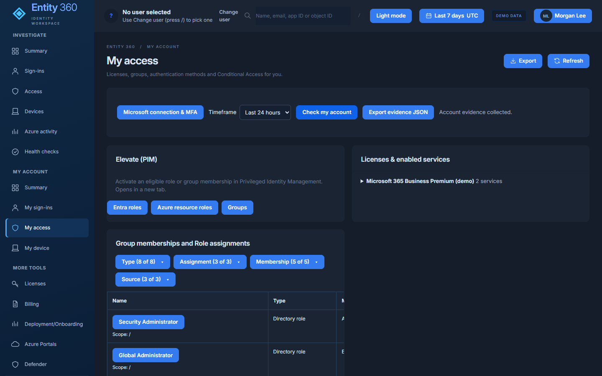
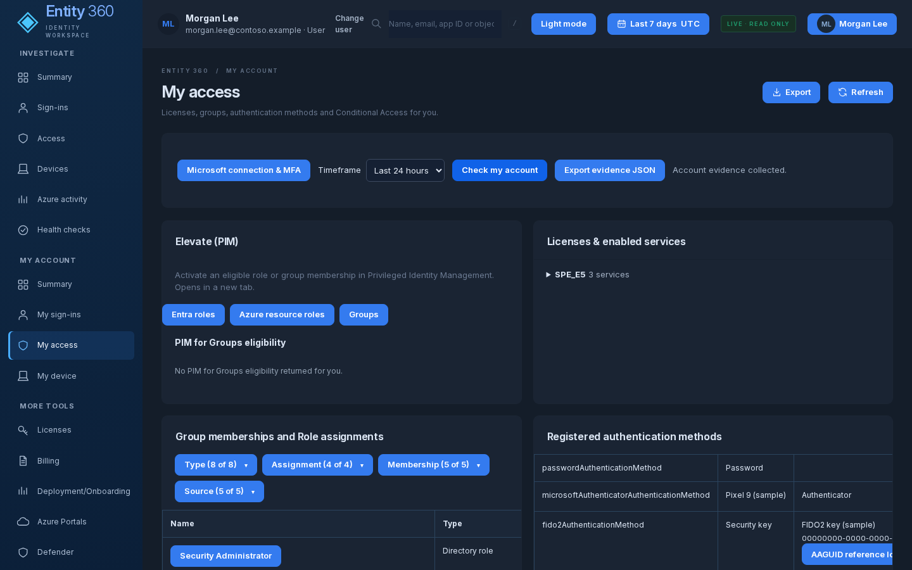
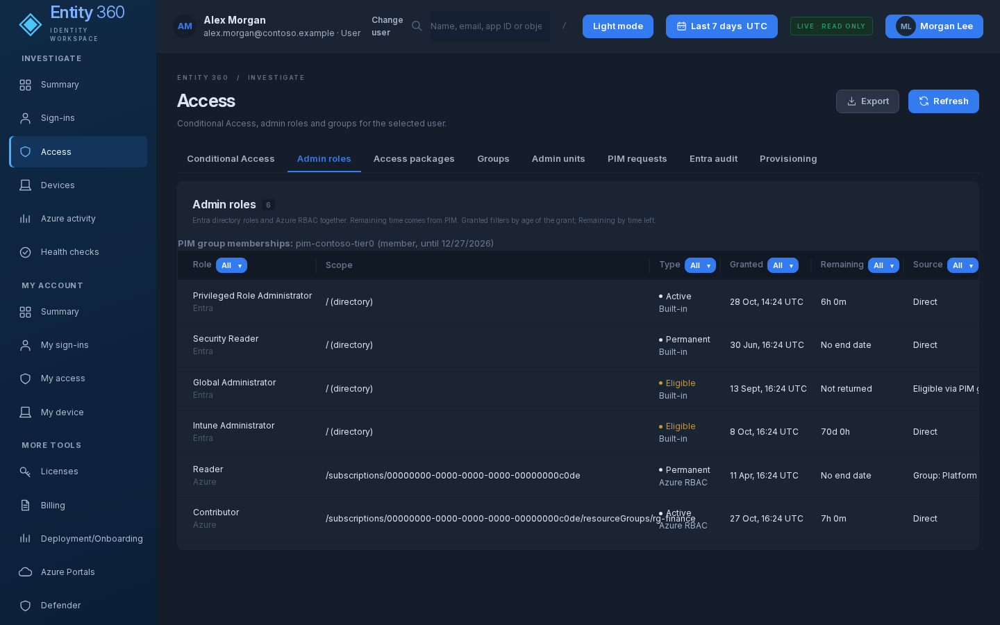
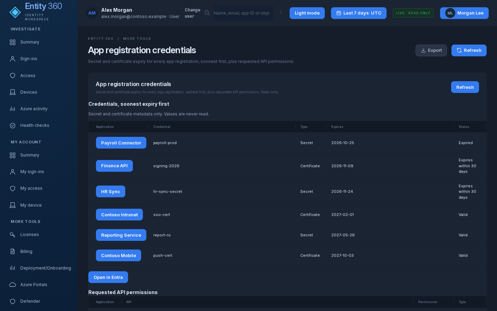

# e360 - Entity 360

Entity 360 is a viewer-scoped Microsoft identity investigation dashboard. Pick a user, application or managed identity
and see its sign-ins, access, devices and Azure activity in one place, each with a link to the source portal.
It also gives admins read-only views of tenant identity configuration: settings, authentication, external access,
governance and applications. It is for SecTechTalk admins and analysts who investigate identity questions, and for any
user who wants to check their own account.



*Screenshot: My access, rendered locally with `DEMO_MODE=true` (fictional Contoso data). The running app has demo mode off and requires Entra sign-in.*

The rail groups the pages in sections: **New hire**, **Investigate**, **My account**, **More tools**, **Tenant**,
**On-prem AD**, **Authentication**, **External**, **Governance**, **Apps** and **Tools**. Summary is the default page.
Every page has its own URL (`#signins`, `#findings`, ...), so Back, refresh, shared links and Ctrl+click into a new tab
work. Light and dark follow the operating system, with a toggle and a high contrast mode. The 360 app switcher at the top
of the rail opens the other 360 apps. Under 1024px the rail shows icons only; under 680px it becomes a drawer.
Every table alternates two row shades in light and dark, with hover and selected rows that stand out from both. Every
button that starts a request shows it is working (a spinner and words such as Searching..., Running..., Building PDF...)
and ignores repeat clicks until the request ends, and a press that starts no request (tabs, time chips, an Export with
nothing to export) still shows it was taken; a progress bar runs at the top of the page while any request is open,
and copies, exports and downloads say what happened.
Every section on every page can be collapsed and starts collapsed: an **Expand** button on its heading shows the rest,
**Expand all** / **Collapse all** in the page heading opens or folds the whole page, and a section you open stays open
on that page in this browser until you collapse it again. The rail sections start collapsed too, except the one holding
the current page, and the rail remembers which ones you opened. Export still finds tables inside folded sections. Notices such as "you
don't have access to this page" are never folded. This covers panels, the cards and tables inside them (source
coverage cards, each finding, each table on the tenant pages) and each part of the Setup guide;
`tests/sections.test.mjs` opens every section on every page and fails on any heading that cannot fold.

## Features
Every page is read-only and live (no sample data in the hosted app). A view whose data needs a read permission that
has not been granted says so and names the permission, instead of showing an empty table. Some views need additional
read permissions and show only part of their data until those are granted.

### New hire
- **Start here**: what Entity 360 is, the first 15 minutes, the questions a new admin is asked and where to look for each,
  what every menu section is for, and the words a new hire hears.
- **What it needs**: the Entity 360 app role, the Entra, Intune or Azure role on your own account and the tenant license
  each feature needs (checked against Microsoft Learn on 2026-11-16).
- Both pages are static and need no role.

### Investigate
- **Incidents**: the queue an analyst starts from. Defender XDR incidents (with their alerts, ATT&CK techniques and
  Microsoft's recommended actions) and Identity Protection risky users (with their risk detections) from the last 30
  days, ranked open first, then by severity, then by most recent. Each item lists the users, devices and IP addresses it
  names: **Open person** loads that user's Summary and **Open device** opens Device lookup, so the investigation starts
  from the alert. Items that name the same user or device point at each other, so one attack raised by two tools reads
  as one. Read-only: classifying, assigning and closing stay in the Defender and Entra portals (each item links there).
  Four optional delegated read scopes, granted once by `Grant-E360IncidentScopes.ps1`: `SecurityIncident.Read.All`,
  `SecurityAlert.Read.All`, `IdentityRiskyUser.Read.All` and `IdentityRiskEvent.Read.All`. The viewer also needs
  Security Reader (or Global Reader, Security Operator, Security Administrator); risk data needs Entra ID P2. Each
  source fails on its own and the Sources table names the scope, role or license that is missing. Needs `E360.Reader`.
- **Summary**: overview of the entity, with an account state card (enabled or disabled, sessions revoked).
- **PDF report**: one PDF with everything Entity 360 can read about a single user, app, managed identity or device (the
  **PDF report** button on the Summary strip and on the device card). Every source is read again with the viewer's own
  token at that moment; a source that fails becomes a NOT READ section with the reason. Bookmarks and page numbers, no
  third-party PDF library, one audit line per report. Needs `E360.Reader`.
- **Sign-ins**: why a sign-in succeeded, failed or was blocked.
  - Columns for tenant, sign-in type (interactive, non-interactive, service principal, managed identity) and session sign-in.
  - Detailed lookup: authentication requirement with the method actually used (for example "Multifactor authentication: Passkey",
    Temporary Access Pass, certificate), and a **Risk** column (risk level during sign-in and risk state).
  - Conditional Access results include report-only outcomes ("Report-only: would block / pass / prompt") and
    "Auth strength not met".
- **Access**
  - Tabs are A-Z with portal links for each tab (stacked, with a note on what each opens) to the matching Entra, Intune
    or PIM blade.
  - **Groups**: a Kind column showing Role-assignable, Dynamic and Synced from on-premises groups.
  - **AD groups**: every on-premises AD security group the user is in across the whole forest, direct, nested or as the
    primary group, with scope (Global, Domain local, Universal, Built-in), SAM name, SID, the group each nested
    membership comes through, and whether the group syncs to Entra. Read live from a domain controller by
    `server/ad/Get-E360AdGroups.ps1` (read-only LDAP), so groups that never sync (Domain Users, Domain Admins, BUILTIN
    groups, groups outside the sync scope, domain local groups in other domains) are included. Needs Entity 360 on
    Windows with a line of sight to a domain controller; setup is in
    [Connect on-premises Active Directory](#connect-on-premises-active-directory). Without it the tab shows only groups
    synced to Entra and says why. A cloud-hosted copy (Azure Container Apps or App Service, detected automatically;
    `E360_HOSTING=cloud|local` overrides) never tries LDAP and shows a warning that on-premises AD is out of reach from
    the cloud by design.
  - **Admin roles**: Type (Built-in, Custom, Azure RBAC); Scope shows the directory, an administrative unit
    ("Admin unit: name") or a single app ("App: name"); effective permissions of each role; PIM activation rules
    (duration, MFA, justification, approval) for Entra roles. Roles held through a group the user is PIM-eligible for
    show "Eligible via PIM group name", and a **PIM group memberships** line lists every PIM for Groups eligibility
    (group, member or owner, end date).
  - **Conditional Access**: a Controls column with the grant and session controls applied.
  - **App permissions**: credential Expires column; delegated grants marked Admin consent or User consent; app role
    assignments and the SSO mode of each app.
  - **Access packages**: policies scoped to a connected organization show "For connected org: name".
  - **Licenses**: whether each license is direct or group-based (and which group), plus group licensing errors.
- **PIM**: Entra roles, PIM groups and Azure roles the user is eligible for or holds.
- **Devices**: the person's Intune devices (primary user) and Entra devices they registered or own, including ones not
  enrolled in Intune. Each card shows compliance, OS version, model, serial number, ownership, encryption, enrollment
  date and join type, with **Open device page**.
- **Device lookup**: find a device by name, serial number, Entra device ID or Intune ID (also from Change user). The
  device page shows full Entra and Intune details, policy states, and the people tied to it: the Intune primary user,
  Entra registered owners and users, and (with `ENABLE_GRAPH_BETA=true`) everyone Intune saw log on, each with
  **Open person**. Uses Device.Read.All and DeviceManagementManagedDevices.Read.All, both already requested.
- **Azure activity**: Azure activity log for the entity.
- **Health checks**: Intune health run and which sources returned data, plus Entity 360 hosting ingress state (open or
  IP-restricted), read with the viewer's own Azure token.
- **Remediation results**: network connectivity Remediation results per device, as reported to Intune.
- **Authorization log**: allow and deny decisions for Entity 360 features (needs `E360.Admin`).
- Investigate pages show a denial card naming the missing role when the viewer lacks `E360.Reader`.

### My account
- **Summary**, **My sign-ins** and **My device** (with join type).
- **My PIM**: activate or deactivate your own eligible Entra roles, PIM groups and Azure roles.
- **My access**: licenses, groups, roles, authentication methods, Conditional Access and PIM. Shows the user's own PIM for
  Groups eligibility (Eligible (PIM), remaining time) and each role that group holds, the date an eligibility was granted,
  administrative unit scopes, and elevation links to PIM. Names link to their Entra pages.

### More tools
- Licenses, Billing, Deployment/Onboarding, Azure Portals, Defender, Error code lookup, Connection & setup, Setup guide.
- **Emergency access**: break-glass accounts with Conditional Access exclusions (direct and through groups), last sign-in,
  roles, and the Azure alert rules that watch them.
- **Logs**: Log Analytics workspaces and workbooks, plus a fixed set of saved read-only KQL queries (sign-in failures,
  audit changes and similar). Arbitrary KQL is not accepted.
- Directory insights used across pages: administrative units, PIM requests, the Entra audit log, provisioning logs,
  Conditional Access What If inputs, PIM for Groups elevation and Entra diagnostic settings.
- Device snapshot import, and a local collector (`public/Collect-Entity360Device.ps1`) that works only when browser and
  server run on the same PC.
- Evidence export (JSON), table export and the single-entity PDF report.

### Tenant
- **Security hardening** (`#findings`): the **Entra ID findings** section is one ranked list of what Entity 360 already reads: admins and users without MFA, break-glass gaps, expired
  or expiring app credentials, stale guests, apps open to everyone, and on-premises AD sync problems. Each finding has a
  severity, the affected items (each linked to its Entra page), a playbook, a button to the Entra page where it is fixed,
  Microsoft's guidance and a link to the Entity 360 page with the full list. A read that fails shows as "Could not check"
  with Microsoft's reason. "Could not check" and "Passing" cards are grouped under their own headings below the ranked
  findings. No extra permission.
- **AD posture** (the second section of Security hardening, folding on its own): Active Directory and AD CS hardening for every domain in the on-premises forest,
  with a domain picker. Certificate templates checked for ESC1, ESC2, ESC3, ESC4, ESC9 and ESC15 and CAs for web enrollment
  over HTTP (ESC8); LDAP signing tested live on every DC; LDAP channel binding, SMB signing and the LAN Manager level read
  from the GPOs in SYSVOL; Kerberoastable service accounts (gMSA candidates), AS-REP roastable accounts, unconstrained
  delegation, krbtgt password age, computers without LAPS and every domain trust with its direction and SID filtering.
  Each domain gets a score (checked controls passing, weighted by severity) kept once a day, and a PDF report with the
  trend. Read-only over the AD groups connection (Set-E360AdReader.ps1); nothing is installed on the DCs. CA registry
  settings (ESC6, ESC7, ESC11) are not reachable this way, and the page says so.
- **Settings**: user, guest and device settings plus security defaults, from Entra policies.
- **Domains**: verified domains, organization details and company branding.
- **Roles**: roles in use and custom roles, PIM eligibility counts, administrative units and their scoped admins.

### On-prem AD
- **Sync health**: opens with a Healthy / Needs attention / Failing verdict. Covers Entra Cloud Sync (configurations and
  their jobs: quarantine, failures, paused jobs, age of the last good run) and Entra Connect Sync (last cycle age, warning
  after 1 hour and failure after 3, password hash sync, sync errors, pending exports, accidental delete protection). Once
  Cloud Sync is running, Connect's frozen server, version and export counts are labelled as not current and collapsed,
  so a tenant moving from Connect Sync to Cloud Sync (Connect left in staging mode until it is uninstalled) reads
  correctly during the move.
  Optional scopes `OnPremDirectorySynchronization.Read.All` and `Synchronization.Read.All` (granted by
  `Grant-E360OnPremSyncScope.ps1` and `Grant-E360CloudSyncScope.ps1`); without them the page says Partly checked and
  names the permission.
- **Groups**: groups synced from on-premises AD with NetBIOS domain, SAM name, SID, members and the apps they grant.

### Authentication
- **Methods policy**: which authentication methods are enabled and for whom, the registration campaign and system-preferred MFA.
- **MFA strength**: every Entra MFA method ranked strongest to weakest (FIDO2 security key, Windows Hello for Business,
  Platform Credential for macOS, multifactor certificate-based authentication, Authenticator passkey, synced passkey,
  phone sign-in, push, hardware OATH, TOTP, SMS, voice). For each: whether the Authentication methods policy has it on
  (attestation, key restrictions, CBA binding and Authenticator mode taken into account), how many users registered it,
  and how many enabled MFA or authentication-strength Conditional Access policies accept it. The verdict names the
  weakest method that is on, registered and accepted by every MFA policy. Each missing method has a setup panel with
  the steps, the PowerShell to run (shown, never run by Entity 360) and how to check it. No extra permission.
- **Registration**: MFA and self-service password reset registration across users, with users not registered for MFA
  (needs the Reports Reader role or higher).
- **Conditional Access**: every policy with its state, plus named locations, authentication contexts and authentication strengths.

### External
- **Guests**: guest accounts with invitation state and last sign-in, stale guests first, grouped by home domain.
- **Cross-tenant**: external collaboration settings plus default and per-organization cross-tenant access.

### Governance
- **Entitlements**: catalogs, access packages, connected organizations and the external user lifecycle.
- **PIM**: activation rules for the Entra roles in use and recent PIM activity from the audit log.
- **PIM Azure**: eligible and active Azure role assignments across your subscriptions (needs Azure connected).
- **Access report**: on demand, who has access to a group, a directory role or a user, with PIM state and last sign-in.
  CSV export; nothing is stored (needs `E360.Admin`).

### Apps
- **Enterprise apps**: every integrated app with publisher, enabled state, assignment required, visibility to users,
  SSO mode and owners (open apps first), plus tenant app settings (who can register apps, user consent policy).
- **App registrations**: summary counts, secret and certificate expiry for every app (Expired, Expires in 30 days, Valid;
  soonest first) and requested API permissions.
- **Consent**: user consent policy, the admin consent workflow settings and permission grant policies.

## Screenshots
| | |
|---|---|
|  |  |
| *My access* | *Access: admin roles and PIM eligibility* |
|  | |
| *Apps: app registration credentials* | |

## Architecture
- Node 22 + Express (`server/`), static UI (`public/`), MSAL Node for sign-in.
- Runs today on a local Windows PC, always on and private: `http://localhost:3600`, bound to 127.0.0.1 only. A scheduled
  task starts it at logon from a clean worktree of `origin/main`, restarts node within 5 seconds if it stops, and the task
  restarts every minute if it fails. Locally the Key Vault signs the sign-in assertion with the operator's own `az login`,
  and the audit trail is written to a local folder.
- Azure Container Apps `app-e360` in `rg-e360` (westus3), consumption plan, 0-1 replicas, image on GitHub Container Registry
  (`ghcr.io/your-org/entity-360`), no Log Analytics workspace, is deactivated, not deleted, until Entity 360 is
  published. Hosted mode is switched on by `PUBLIC_BASE_URL`.
- Sign-in: authorization code + PKCE with a certificate. The certificate key stays in Key Vault (`kv-e360-auth-xxxxx`,
  key `entity360-auth`); the app gets a Key Vault token from its managed identity and asks the vault to sign the assertion.
  No client secret is supported.
- Sessions are in memory (max 1 replica). They end when the app scales to zero; users sign in again.

## Security model
- **Delegated, read-only.** Every backend call runs with the viewer's own token and the source decides what they can see.
  The app requests only delegated read scopes (no application permissions, no write scopes). A denial is final; nothing
  retries a denied read with another identity.
- Scopes include User/Group/Application/Policy/AuditLog/RoleManagement/Directory reads plus
  `AdministrativeUnit.Read.All`, `EntitlementManagement.Read.All` and `PrivilegedEligibilitySchedule.Read.AzureADGroup`.
  Pages that need further scopes (for example identity risk, access reviews, terms of use, lifecycle workflows) are
  listed as deferred in the app rather than requested.
- App roles `E360.Reader`, `E360.SignIns`, `E360.Intune`, `E360.Billing`, `E360.Admin` gate which features a person can open. Roles come
  only from the validated ID token; unknown role names are dropped. `E360.Admin` includes `E360.Reader` (it opens every
  Reader page); no other role includes another, so Sign-ins, Intune and Billing still need their own role
  (`public/role-model.js`).
- **Roles are re-checked during the session.** At most every 5 minutes (and when the person selects **Check my roles again**
  on a denial), the server asks Entra for a fresh ID token with the session's own refresh token and takes its roles claim.
  A removed role or an ended PIM for Groups activation stops working on the next request. If Entra refuses the token
  (account disabled, assignment removed, sessions revoked), the session ends and the browser signs in again. If Entra
  cannot be reached, role-gated features fail closed (HTTP 503) until a re-check succeeds, retried every 30 seconds.
  Every role change and ended session is audited. Code: `server/role-recheck.mjs`.
- **Durable audit trail.** Remediation run requests, access report runs, PIM requests, sign-ins, authorization denials and
  role re-checks are written to stdout (`E360_AUDIT {json}`) and to a private GitHub repository through the contents API,
  one JSON Lines file per UTC day (`audit/YYYY-MM/YYYY-MM-DD.jsonl`). The token has Contents read/write on that one
  repository only and is a Container Apps secret, the same pattern as HeatMap 360. After a restart the Authorization log
  and Run requests pages reload the last 14 days. Setup: [DEPLOY.md](DEPLOY.md#durable-audit-trail). Code: `server/audit-trail.mjs`.
- Billing is denied unless you are in `sg-e360-billing`.
- The E360 MFA Conditional Access policy is in report-only mode.
- No secrets in the app or image. `.env`, certificates, `.backups`, `.runtime` and tests are excluded by `.dockerignore`.
  The container runs as the non-root `node` user. The audit repository token is a Container Apps secret reference, never
  in git or the image.
- The hosted app accepts only its own host (plus localhost for probes), trusts the ingress proxy and uses a `__Host-`
  prefixed `Secure` session cookie; HSTS covers subdomains.
- Content Security Policy is enforced; Trusted Types run in report-only mode, and the browser's reports are collected at
  `/csp-report` (page, file, line and sink only).
- Every pull request runs a security gate (`.github/workflows/security.yml`): `npm audit` fails on a high or critical
  advisory in a shipped package, gitleaks scans for committed secrets, and the tests run. Actions are pinned to commit
  SHAs and Dependabot keeps npm packages and actions current.
- Keyboard and screen reader access: real buttons and links, tabs linked to their panels with arrow keys, and every
  disabled button says why.
- Demo mode (`DEMO_MODE=true`) is local only and off by default; a hosted session starts signed out, never in demo.

## Getting started

### Run locally
```powershell
.\Configure-Entity360.ps1 -TenantId <tenant-guid> -ClientId <app-guid>   # writes .env from .env.example
.\Start-Entity360.ps1                                                    # npm ci if needed, then http://localhost:3600
.\Stop-Entity360.ps1
```
Settings are documented in `.env.example`. To look around with fictional data only: `$env:DEMO_MODE='true'; npm start`.

### Run it always on (how Entity 360 is hosted today)
```powershell
C:\path\to\scripts\Install-E360Local.ps1                 # dry run: checks and shows what it would do
C:\path\to\scripts\Install-E360Local.ps1 -Apply          # install and start on http://localhost:3600
C:\path\to\scripts\Install-E360Local.ps1 -Update -Apply  # after a merge: pull main into the run copy and restart
C:\path\to\scripts\Install-E360Local.ps1 -Status         # task state, port, health
C:\path\to\scripts\Install-E360Local.ps1 -Remove -Apply  # stop and remove (audit and logs are kept)
```
Nothing in Azure or the app registration is changed by this script.

### Connect on-premises Active Directory
Entity 360 reads on-premises AD two ways. Both are read-only, and both are optional.

| What | Feeds | How it connects | Setup |
|---|---|---|---|
| Directory sync status | ON-PREM AD > Sync health, Groups; the sync finding | Microsoft Graph, with the viewer's own token. Works from anywhere, cloud-hosted copies included. | `Grant-E360OnPremSyncScope.ps1` adds `OnPremDirectorySynchronization.Read.All` (Connect Sync features); `Grant-E360CloudSyncScope.ps1` adds `Synchronization.Read.All` (Cloud Sync job status). Each appends one delegated read scope to the existing admin-consent grant and backs up the old scope string. |
| Live forest group membership (the AD connector) | INVESTIGATE > Access > AD groups | `server/ad/Get-E360AdGroups.ps1` binds to a domain controller over LDAP (389) and the global catalog (3268) and reads `tokenGroups`, domain local groups in other domains and the `memberOf` chain. | A plain domain user, then `Set-E360AdReader.ps1` on the Entity 360 host. |

Setting up the AD connector:
1. On a domain controller, as a Domain Admin, create the reader account. It is a member of Domain Users only, with no
   admin rights and no extra groups; any domain user can read group membership. Use `-Path` to put it in an OU outside
   the Entra sync scope so it does not sync to Entra.
2. On the computer that runs Entity 360, as the Windows user that runs it, from the Entity 360 folder, run
   `Set-E360AdReader.ps1`. It checks ports 389, 3268 and 88, asks for the password, tests the bind, saves the credential
   with `Export-Clixml` (DPAPI: only that Windows user on that computer can open it; the password never goes into `.env`,
   logs or git), writes `E360_AD_SERVER` and `E360_AD_CREDENTIAL` to `.env`, and runs a real query for the reader
   account. Every network step has a hard time limit, so it cannot hang. Kerberos is tried first; when the host is not
   domain-joined and only NTLM works, the DC is saved by IP address so Entity 360's own queries use NTLM too. On a
   domain-joined host the credential is optional: Entity 360 then uses its own Windows identity.
3. Restart Entity 360 (for the always-on install: `Install-E360Local.ps1 -Update -Apply`, which copies the updated
   `.env` into the run copy).

```powershell
.\New-E360AdReaderAccount.ps1 -Path 'OU=Service Accounts,DC=contoso,DC=com'          # on a DC: dry run
.\New-E360AdReaderAccount.ps1 -Path 'OU=Service Accounts,DC=contoso,DC=com' -Apply   # create svc-e360-reader
.\Set-E360AdReader.ps1 -Server dc01.contoso.com -UserName 'CONTOSO\svc-e360-reader'          # on the Entity 360 host: checks only
.\Set-E360AdReader.ps1 -Server dc01.contoso.com -UserName 'CONTOSO\svc-e360-reader' -Apply   # save, test, write .env
.\Set-E360AdReader.ps1 -Remove -Apply                                                        # undo
```
`E360_AD_ENABLED=false` turns the live read off. Domain controllers are on the private network by design, so the AD
connector works only on a copy that runs inside it, such as the local install; Sync health works everywhere.

### Connect an AI client (MCP server)
`server/mcp.mjs` is a Model Context Protocol server. Any MCP client can use it: Claude Desktop, Claude Code, LM Studio,
Jan, or Open WebUI in front of Ollama, so a fully offline local model works the same as Claude.

- **Tools (all read-only):** `search`, `investigate`, `device`, `findings`, `signins`, `emergency_access`,
  `find_group_or_role`, `access_report`. Each reuses the data function behind the matching page and needs the same E360
  app role (`access_report` and `find_group_or_role` are E360.Admin). No remediation runs, PIM requests or device collection.
- **Sign-in:** the same confidential registration and Key Vault key as the web app, signed in once in the browser
  (`sign-in`, auth code + PKCE on `http://localhost:3602/auth/callback`; Entra ignores the port of a localhost redirect
  URI, so the registered `:3600` URI covers it). Delegated: it sees only what you can see. The cached sign-in is
  DPAPI-encrypted under `%LOCALAPPDATA%\Entity360\mcp`. Roles are re-read from a fresh ID token every 5 minutes.
- **Audit:** every live tool call is an `mcp-tool` record in the Entity 360 audit trail (tool, who, outcome, time).
- **Transports:** stdio (the client starts it) and Streamable HTTP on `127.0.0.1:3601/mcp` only, with a bearer key
  (`node server/mcp.mjs key`), Host and Origin checks.
- **Small models:** answers are shortened by default (15 rows, 300-character strings); `detail: true` returns more.
  Every shortened list reports how many items it left out (`count` = listed + `more`), so a short answer never
  under-counts.
- **Data:** the model can run offline, but tenant data still comes live from Microsoft Graph. `--demo` serves the
  fictional Contoso data with no sign-in and no internet. With Claude, tool results go to Anthropic; with a local
  model they stay on this PC.

```powershell
C:\e360-local\Connect-E360Mcp.ps1                            # dry run: Claude Code, Claude Desktop, LM Studio
C:\e360-local\Connect-E360Mcp.ps1 -Apply                     # sign in once and register e360 with those clients
C:\e360-local\Connect-E360Mcp.ps1 -Client OpenWebUI -Apply   # HTTP server at logon + URL and key for Open WebUI
C:\e360-local\Connect-E360Mcp.ps1 -Remove -Apply             # remove from every client, stop HTTP, sign out
```
For Claude Desktop the script writes every config location that exists, including the one current builds read under
`%LOCALAPPDATA%\Claude-Data`, and refuses to run while Claude Desktop is open (the app rewrites its config on exit);
it never stops Claude Code. Quit and reopen Claude Desktop afterwards.

By hand: `node --env-file=.env server/mcp.mjs sign-in | status | key | sign-out`, `node --env-file=.env server/mcp.mjs`
(stdio) or `... --http`. For Jan, add a stdio server with command `node` and arguments
`--env-file=C:\e360-local\.env C:\e360-local\server\mcp.mjs`.

### Test
```powershell
npm ci; npm test; npm run check
```
About 520 tests, including checks that every page makes only GET calls. The browser tests use Playwright (Edge on
Windows, Chromium elsewhere) and skip when no browser is installed. Every test server takes a free port from the OS
(`tests/free-port.mjs`), so the suite runs while Entity 360 or another app is already listening on the same PC.
`npm test` loads `tests/test-env.mjs` first, which turns live AD reads off, so the tests never query a real domain
controller even on a domain-joined Windows PC.

### Build and deploy to Azure (deactivated)
Kept for when Entity 360 is published. See [DEPLOY.md](DEPLOY.md) for prerequisites, costs, verification and rollback.
```powershell
C:\path\to\scripts\Test-E360DeployPrereqs.ps1          # read-only checks
C:\path\to\scripts\Build-E360Image.ps1 -Apply -Push    # build + push ghcr.io/your-org/entity-360:<yyyyMMdd-HHmm>
cd C:\path\to\scripts
.\Deploy-E360ContainerApp.ps1                       # dry run
.\Deploy-E360ContainerApp.ps1 -Apply -Image ghcr.io/your-org/entity-360:<yyyyMMdd-HHmm>
.\Deploy-E360ContainerApp.ps1 -Rollback -Apply      # back to the previous dated tag
```
Every deploy pins a dated image tag, then verifies the new revision is Healthy, takes 100% of traffic and that
`/auth/login` redirects to Entra, and prints the rollback command.

## Hosted demo for other tenants

`E360_HOSTED_DEMO=true` turns a hosted copy into a public demo that anyone signs in to with their **own** work or school
tenant. It never reads the host's tenant for a visitor. `New-E360HostedDemo.ps1` creates it (dry run by default):
a multi-tenant registration "Entity 360 (hosted demo)" and container app `app-e360-demo` (min 0 / max 1 replica).

- Sign-in goes through `/organizations`. The visitor's tenant is the token's `tid`, which must match `iss`
  (`https://login.microsoftonline.com/{tid}/v2.0`) and the account; later token calls use that tenant's authority.
- One tenant per browser session. Adding or switching tenants, device code sign-in and portfolio discovery are off.
- Read-only: write scopes (`ReadWrite`, `Write`, `PrivilegedOperations`) are never requested, and PIM activation,
  Intune remediation runs, the server-side device collector, the authorization log and the fleet deployment log answer 403.
- Nothing about a visitor is stored: tokens live in process memory, sessions end after 60 idle minutes, the durable
  audit store is off and audit lines keep the tenant ID and outcome without names. App roles are not enforced; Graph
  still enforces the visitor's own permissions. Each tenant is limited to 600 API requests a minute.
- Signed-out visitors see `public/hosted-welcome.html` (what it reads, use a test tenant, how to remove it).
  Their admin approves the app once at `/auth/login?consent=1`.
- On-prem AD pages stay unavailable when cloud hosted (see the AD groups warning).

## Status and roadmap
- Runs locally, always on; the Azure Container App is deactivated until Entity 360 is published.
- MCP server for AI clients (Claude, LM Studio, Open WebUI, Jan): built, read-only.
- Hosted demo for other tenants: built; `New-E360HostedDemo.ps1` creates it (dry run by default).
- Incidents queue (Defender XDR and Identity Protection), new hire, tenant (with Security hardening and AD posture), on-prem AD (Connect Sync and Cloud Sync status, and live forest group membership
  through the AD connector on local copies), authentication, external identities,
  governance and app pages are live (read-only).
- E360 MFA Conditional Access is report-only; PIM activation for billing applies once that plan step is done.
- Identity Protection risky users show in the Incidents queue once `Grant-E360IncidentScopes.ps1` grants the scopes;
  a network access page still waits on additional delegated read scopes.
- Device data target design: Intune Remediations.
- Custom domain `e360.contoso.com`: planned, not scripted (see DEPLOY.md).
