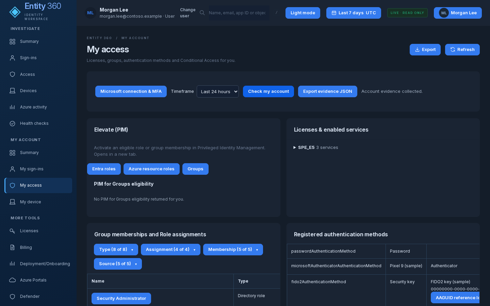
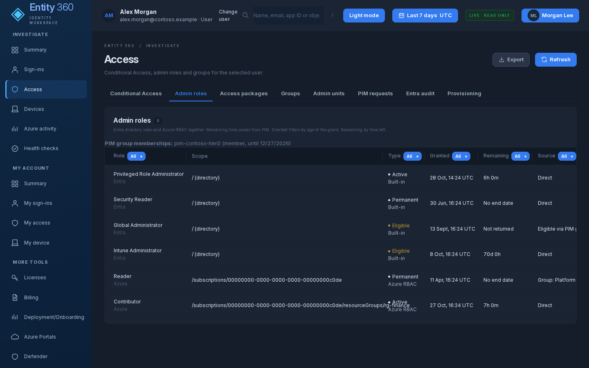
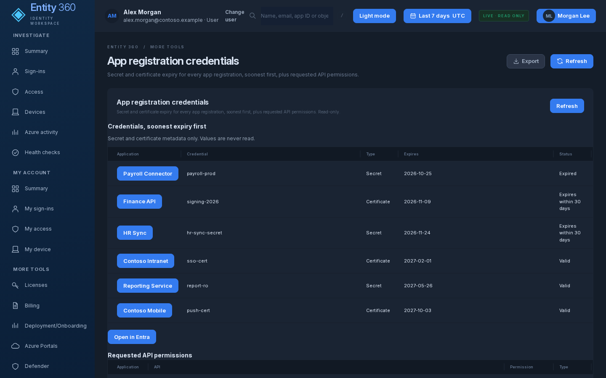

# e360 - Entity 360

Entity 360 is a viewer-scoped Microsoft identity investigation dashboard. Pick a user, application or managed identity
and see its sign-ins, access, devices and Azure activity in one place, each with a link to the source portal.
It also gives admins read-only views of tenant identity configuration: settings, authentication, external access,
governance and applications. It is for SecTechTalk admins and analysts who investigate identity questions, and for any
user who wants to check their own account.


*Screenshot: My access, rendered locally with `DEMO_MODE=true` (fictional Contoso data). The hosted app has demo mode off and requires Entra sign-in.*

## Features
Every page is read-only and live (no sample data in the hosted app). A view whose data needs a read permission that
has not been granted says so and names the permission, instead of showing an empty table. Some views need additional
read permissions and show only part of their data until those are granted.

### Investigate
- **Summary**: overview of the entity, with an account state card (enabled or disabled, sessions revoked).
- **Sign-ins**: why a sign-in succeeded, failed or was blocked.
  - Columns for tenant, sign-in type (interactive, non-interactive, service principal, managed identity) and session sign-in.
  - Detailed lookup: authentication requirement with the method actually used (for example "Multifactor authentication: Passkey",
    Temporary Access Pass, certificate), and a **Risk** column (risk level during sign-in and risk state).
  - Conditional Access results include report-only outcomes ("Report-only: would block / pass / prompt") and
    "Auth strength not met".
- **Access**
  - **Groups**: a Kind column showing Role-assignable, Dynamic and Synced from on-premises groups.
  - **Admin roles**: Type (Built-in, Custom, Azure RBAC); Scope shows the directory, an administrative unit
    ("Admin unit: name") or a single app ("App: name"); effective permissions of each role; PIM activation rules
    (duration, MFA, justification, approval) for Entra roles. Roles held through a group the user is PIM-eligible for
    show "Eligible via PIM group name", and a **PIM group memberships** line lists every PIM for Groups eligibility
    (group, member or owner, end date).
  - **Conditional Access**: a Controls column with the grant and session controls applied.
  - **App permissions**: credential Expires column; delegated grants marked Admin consent or User consent; app role
    assignments and the SSO mode of each app.
  - **Access packages**: policies scoped to a connected organization show "For connected org: name".
  - **Licenses**: whether each license is direct or group-based (and which group), plus group licensing errors.
- **Devices**: join type (Entra joined, Hybrid joined, Registered) and compliance.
- **Azure activity**: Azure activity log for the entity.
- **Health checks**: includes Entity 360 hosting ingress state (open or IP-restricted), read with the viewer's own Azure token.

### My account
- **Summary**, **My sign-ins** and **My device** (with join type).
- **My access**: licenses, groups, roles, authentication methods, Conditional Access and PIM. Shows the user's own PIM for
  Groups eligibility (Eligible (PIM), remaining time) and each role that group holds, the date an eligibility was granted,
  administrative unit scopes, and elevation links to PIM.

### More tools
- Licenses, Billing, Deployment/Onboarding, Azure Portals, Defender, Error code lookup, Connection & setup, Setup guide.
- **Emergency access**: break-glass accounts with Conditional Access exclusions (direct and through groups), last sign-in,
  roles, and the Azure alert rules that watch them.
- **Logs**: Log Analytics workspaces and workbooks, plus a fixed set of saved read-only KQL queries (sign-in failures,
  audit changes and similar). Arbitrary KQL is not accepted.
- Directory insights used across pages: administrative units, PIM requests, the Entra audit log, provisioning logs,
  Conditional Access What If inputs, PIM for Groups elevation and Entra diagnostic settings.
- Device snapshot import, and a local collector (`public/Collect-Entity360Device.ps1`) that works only when browser and
  server run on the same PC.
- Evidence export (JSON) and table export.

### Tenant
- **Settings**: user, guest and device settings plus security defaults, from Entra policies.
- **Domains**: verified domains, organization details and company branding.
- **Roles**: roles in use and custom roles, PIM eligibility counts, administrative units and their scoped admins.
- **Hybrid**: directory synchronization status.

### Authentication
- **Methods policy**: which authentication methods are enabled and for whom, the registration campaign and system-preferred MFA.
- **Registration**: MFA and self-service password reset registration across users, with users not registered for MFA
  (needs the Reports Reader role or higher).
- **Conditional Access**: every policy with its state, plus named locations, authentication contexts and authentication strengths.

### External
- **Guests**: guest accounts with invitation state and last sign-in, stale guests first, grouped by home domain.
- **Cross-tenant**: external collaboration settings plus default and per-organization cross-tenant access.

### Governance
- **Entitlements**: catalogs, access packages, connected organizations and the external user lifecycle.
- **PIM**: activation rules for the Entra roles in use and recent PIM activity from the audit log.
- **PIM Azure**: eligible and active Azure role assignments across your subscriptions (needs Azure connected).

### Apps
- **Enterprise apps**: every integrated app with publisher, enabled state, assignment required, visibility to users,
  SSO mode and owners (open apps first), plus tenant app settings (who can register apps, user consent policy).
- **App registrations**: summary counts, secret and certificate expiry for every app (Expired, Expires in 30 days, Valid;
  soonest first) and requested API permissions.
- **Consent**: user consent policy, the admin consent workflow settings and permission grant policies.

## Screenshots
| | |
|---|---|
|  |  |
| *My access* | *Access: admin roles and PIM eligibility* |
|  | |
| *Apps: app registration credentials* | |

## Architecture
- Node 22 + Express (`server/`), static UI (`public/`), MSAL Node for sign-in.
- Local: `http://localhost:3600`, bound to 127.0.0.1.
- Hosted: Azure Container Apps `app-e360` in `rg-e360` (westus3), consumption plan, 0-1 replicas, image on GitHub Container Registry
  (`ghcr.io/your-org/entity-360`), no Log Analytics workspace. Hosted mode is switched on by `PUBLIC_BASE_URL`.
- Sign-in: authorization code + PKCE with a certificate. The certificate key stays in Key Vault (`kv-e360-auth-xxxxx`,
  key `entity360-auth`); the app gets a Key Vault token from its managed identity and asks the vault to sign the assertion.
  No client secret is supported.
- Sessions are in memory (max 1 replica). They end when the app scales to zero; users sign in again.

## Security model
- **Delegated, read-only.** Every backend call runs with the viewer's own token and the source decides what they can see.
  The app requests only delegated read scopes (no application permissions, no write scopes). A denial is final; nothing
  retries a denied read with another identity.
- Scopes include User/Group/Application/Policy/AuditLog/RoleManagement/Directory reads plus
  `AdministrativeUnit.Read.All`, `EntitlementManagement.Read.All` and `PrivilegedEligibilitySchedule.Read.AzureADGroup`.
  Pages that need further scopes (for example identity risk, access reviews, terms of use, lifecycle workflows) are
  listed as deferred in the app rather than requested.
- App roles `E360.Reader`, `E360.SignIns`, `E360.Intune`, `E360.Billing` gate which features a person can open. Roles come
  only from the validated ID token; unknown role names are dropped.
- Billing is denied unless you are in `sg-e360-billing`.
- The E360 MFA Conditional Access policy is in report-only mode.
- No secrets in the app or image. `.env`, certificates, `.backups`, `.runtime` and tests are excluded by `.dockerignore`.
  The container runs as the non-root `node` user.
- The hosted app accepts only its own host (plus localhost for probes), trusts the ingress proxy and sets a `Secure` session cookie.
- Demo mode (`DEMO_MODE=true`) is local only and off by default; a hosted session starts signed out, never in demo.

## Getting started

### Run locally
```powershell
.\Configure-Entity360.ps1 -TenantId <tenant-guid> -ClientId <app-guid>   # writes .env from .env.example
.\Start-Entity360.ps1                                                    # npm ci if needed, then http://localhost:3600
.\Stop-Entity360.ps1
```
Settings are documented in `.env.example`. To look around with fictional data only: `$env:DEMO_MODE='true'; npm start`.

### Test
```powershell
npm ci; npm test; npm run check
```
About 200 unit tests, including checks that every page makes only GET calls.

### Build and deploy
See [DEPLOY.md](DEPLOY.md) for prerequisites, costs, verification and rollback.
```powershell
C:\path\to\scripts\Test-E360DeployPrereqs.ps1          # read-only checks
C:\path\to\scripts\Build-E360Image.ps1 -Apply -Push    # build + push ghcr.io/your-org/entity-360:<yyyyMMdd-HHmm>
cd C:\path\to\scripts
.\Deploy-E360ContainerApp.ps1                       # dry run
.\Deploy-E360ContainerApp.ps1 -Apply -Image ghcr.io/your-org/entity-360:<yyyyMMdd-HHmm>
.\Deploy-E360ContainerApp.ps1 -Rollback -Apply      # back to the previous dated tag
```
Every deploy pins a dated image tag, then verifies the new revision is Healthy, takes 100% of traffic and that
`/auth/login` redirects to Entra, and prints the rollback command.

## Status and roadmap
- Hosted on Azure Container Apps; local mode unchanged.
- Tenant, authentication, external identities, governance and app pages are live (read-only).
- E360 MFA Conditional Access is report-only; PIM activation for billing applies once that plan step is done.
- Identity protection and network access pages wait on additional delegated read scopes.
- Device data target design: Intune Remediations.
- Custom domain `e360.contoso.com`: planned, not scripted (see DEPLOY.md).
