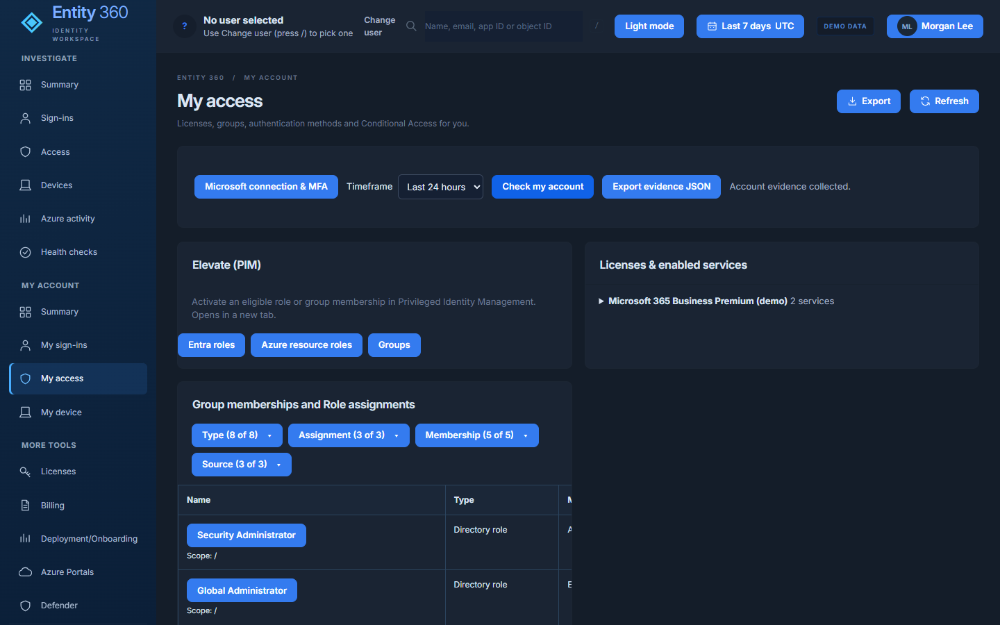

# e360 - Entity 360

Entity 360 is a viewer-scoped Microsoft identity investigation dashboard. Pick a user, application or managed identity
and see its sign-ins, access, devices and Azure activity in one place, each with a link to the source portal.
It is for SecTechTalk admins and analysts who investigate identity questions, and for any user who wants to check
their own account. It is a standalone product and shares no code, identity or Azure resources with other projects.



*Screenshot: My access, rendered locally with `DEMO_MODE=true` (fictional Contoso data). The hosted app has demo mode off and requires Entra sign-in.*

## Features
- **Investigate**: Summary, Sign-ins (why a sign-in succeeded, failed or was blocked), Access, Devices, Azure activity, Health checks.
- **My account**: Summary, My sign-ins, My access (licenses, groups, roles, authentication methods, Conditional Access, PIM elevation links), My device.
- **More tools**: Licenses, Billing, Deployment/Onboarding, Azure Portals, Defender, Error code lookup, Connection & setup, Setup guide.
- Device snapshot import, and a local collector (`public/Collect-Entity360Device.ps1`) that works only when browser and server run on the same PC.
- Evidence export (JSON) and table export.

## Architecture
- Node 22 + Express (`server/`), static UI (`public/`), MSAL Node for sign-in.
- Local: `http://localhost:3600`, bound to 127.0.0.1.
- Hosted: Azure Container Apps `app-e360` in `rg-e360` (westus3), consumption plan, 0-1 replicas, image on GitHub Container Registry
  (`ghcr.io/your-org/entity-360`), no Log Analytics workspace. Hosted mode is switched on by `PUBLIC_BASE_URL`.
- Sign-in: authorization code + PKCE with a certificate. The certificate key stays in Key Vault (`kv-e360-auth-xxxxx`,
  key `entity360-auth`); the app gets a Key Vault token from its managed identity and asks the vault to sign the assertion.
  No client secret is supported.
- Sessions are in memory (max 1 replica). They end when the app scales to zero; users sign in again.

## Security model
- Delegated permissions only. Every backend call runs with the viewer's own token and the source decides what they can see.
  A denial is final; nothing retries a denied read with another identity.
- App roles `E360.Reader`, `E360.SignIns`, `E360.Intune`, `E360.Billing` gate which features a person can open. Roles come
  only from the validated ID token; unknown role names are dropped.
- Billing is denied unless you are in `sg-e360-billing`.
- No secrets in the app or image. `.env`, certificates, `.backups`, `.runtime` and tests are excluded by `.dockerignore`.
  The container runs as the non-root `node` user.
- The hosted app accepts only its own host (plus localhost for probes), trusts the ingress proxy and sets a `Secure` session cookie.
- Demo mode (`DEMO_MODE=true`) is local only and off by default; a hosted session starts signed out, never in demo.

## Getting started

### Run locally
```powershell
.\Configure-Entity360.ps1 -TenantId <tenant-guid> -ClientId <app-guid>   # writes .env from .env.example
.\Start-Entity360.ps1                                                    # npm ci if needed, then http://localhost:3600
.\Stop-Entity360.ps1
```
Settings are documented in `.env.example`. To look around with fictional data only: `$env:DEMO_MODE='true'; npm start`.

### Test
```powershell
npm ci; npm test; npm run check
```

### Build and deploy
See [DEPLOY.md](DEPLOY.md) for prerequisites, costs, verification and rollback.
```powershell
C:\path\to\scripts\Test-E360DeployPrereqs.ps1          # read-only checks
C:\path\to\scripts\Build-E360Image.ps1 -Apply -Push    # build + push ghcr.io/your-org/entity-360:<yyyyMMdd-HHmm>
cd C:\path\to\scripts
.\Deploy-E360ContainerApp.ps1                       # dry run
.\Deploy-E360ContainerApp.ps1 -Apply                # deploy or update the image
```

## Status and roadmap
- Hosted on Azure Container Apps; local mode unchanged.
- E360 MFA Conditional Access (plan step 1.7) was last logged as report-only; PIM activation for billing applies once plan step 1.8 is done.
- Device data target design: Intune Remediations (plan Phase 4.6).
- Custom domain `e360.contoso.com`: planned, not scripted (see DEPLOY.md).
